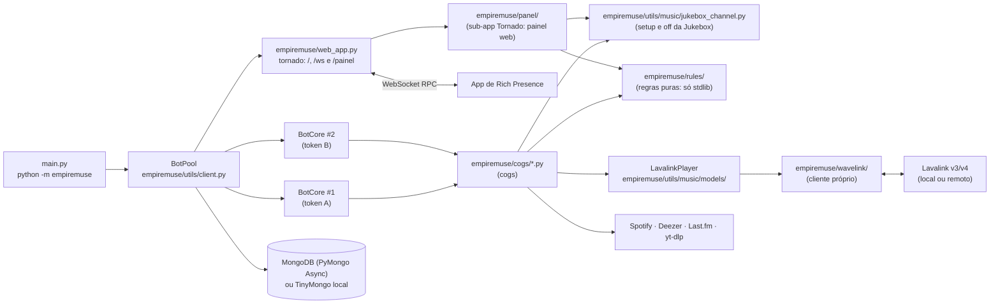

# Arquitetura do EmpireMuse

> EmpireMuse é obra derivada do [MuseHeart-MusicBot](https://github.com/zRitsu/MuseHeart-MusicBot),
> de **zRitsu** (licença GPL-2.0). Este documento descreve o código **como ele está hoje**; as referências
> `arquivo:linha` foram conferidas no código atual e podem deslocar-se com novos commits.

## 1. Visão geral

Um único processo Python (3.14) hospeda **vários bots do Discord** (um por token) e um **servidor web**
(tornado). Todo o áudio é processado por servidores **Lavalink** (v3/v4) ou NodeLink; o bot só controla os
players, a fila, a interface (embeds, botões, selects) e a persistência.

## 2. Processo e inicialização

1. `python -m empiremuse` instancia `BotPool()` e chama `pool.setup()` via `main` em `empiremuse/__main__.py`.
   Na raiz, `main.py` atua como atalho direto chamando `empiremuse.__main__.main()` (`main.py`).
2. A resolução de diretórios é centralizada em `empiremuse/paths.py`:
   - `PROJECT_DIR`: raiz do repositório, onde residem os diretórios de dados estáticos `data/` (servidores Lavalink) e `assets/` (imagens e marca, em subpastas).
   - `PACKAGE_DIR`: raiz do pacote `empiremuse/`, contendo código-fonte e templates compartilhados (`empiremuse/templates/status.html`).
   - `RUNTIME_DIR`: diretório para dados de execução (`local_database/`, `Lavalink.jar`, `application.yml`, `.logs/`, `lavalink.ini` etc.), determinado por `get_runtime_dir()` a partir da variável `EMPIREMUSE_HOME` (com fallback padrão para `Path.cwd().resolve()`).
3. `BotPool.__init__` em `empiremuse/utils/client.py` carrega a configuração (`load_cfg` → `empiremuse.config_loader.load_config`),
   cria caches TTL, clientes Deezer/yt-dlp e restaura o cache de playlist em JSON de `local_database/` sob `RUNTIME_DIR` (`BotPool.load_cache` em `empiremuse/utils/client.py`); os caches do formato antigo não são lidos.
4. `BotPool.setup` em `empiremuse/utils/client.py` executa, em ordem:
   - carrega as skins (`BotPool.load_skins` em `empiremuse/utils/client.py`);
   - monta a lista de nodes Lavalink: lista remota (`AUTO_DOWNLOAD_LAVALINK_SERVERLIST`), variáveis
     `LAVALINK_NODE_*` (JSON) e `lavalink.ini` em `RUNTIME_DIR` (`BotPool.setup` em `empiremuse/utils/client.py`);
   - decide se inicia o Lavalink local: `RUN_LOCAL_LAVALINK` ou nenhum node configurado (`BotPool.setup` em `empiremuse/utils/client.py`);
   - define as intents a partir das chaves `*_INTENT` (`BotPool.setup` em `empiremuse/utils/client.py`);
   - escolhe o banco: `MONGO` preenchido → `MongoDatabase`; caso contrário `LocalDatabase` (`BotPool.setup` em `empiremuse/utils/client.py`)
     — o `LocalDatabase` é sempre instanciado em `RUNTIME_DIR / "local_database"`;
   - cria `SpotifyClient` (se houver credenciais) e `LastFM` (`BotPool.setup` em `empiremuse/utils/client.py`);
   - varre **todas** as variáveis de ambiente/config atrás de strings com formato de token do Discord
     (`token_regex` em `empiremuse/utils/others.py`), de modo que qualquer chave pode conter um token (`BotPool.setup` em `empiremuse/utils/client.py`);
   - cria um `BotCore` por token via `load_bot` em `BotPool.setup` (`empiremuse/utils/client.py`) e, opcionalmente, bots exclusivos de
     servidor a partir de `guild_bots.json` em `RUNTIME_DIR` (`BotPool.setup` em `empiremuse/utils/client.py`);
   - sobe o servidor web com `web_app.start` (se `RUN_RPC_SERVER`) ou roda `run_bots` no loop (`BotPool.setup` em `empiremuse/utils/client.py`).
5. Cada `BotCore` (`empiremuse/utils/client.py`, herda `commands.AutoShardedBot`) executa `initial_setup` depois do
   `on_ready`: carrega os cogs de `empiremuse.cogs`, sincroniza cooldowns e comandos de aplicação, registra `PanelView`
   (`initial_setup` em `BotPool.setup`, `empiremuse/utils/client.py`).
6. Ponto de extensão opcional: se existir o pacote `dev.pool_dev`, `PoolDev(self).run()` é executado
   (`BotPool.setup_pool_extras` em `empiremuse/utils/client.py`). Ele não existe no repositório.

### Atualizador (`empiremuse/updater/`)

Pacote do comando `update` (guia: [`guides/auto-update.md`](guides/auto-update.md); decisão: [ADR-0004](adr/0004-auto-update-proxy.md)):

| Módulo | Papel |
|---|---|
| `mode.py` | Detecta o modo: `docker` (com `UPDATE_PROXY_SOCKET`), `panel`, `git` ou `manual` |
| `git_flow.py`, `boot_guard.py` | Modo git: tag anotada oficial, reversão e guarda de boot (roda em `__main__` antes de importar o bot); saída 75 pede reinício ao supervisor |
| `releases.py`, `docker_flow.py`, `proxy_client.py` | Modo Docker: releases imutáveis com digest, plano, pedido do auxiliar ao proxy e acompanhamento |
| `proxy.py` | O proxy: arquivo único só com a biblioteca padrão (`python -I -S`), o único com acesso ao `docker.sock`; cria o auxiliar a partir de um modelo fixo |
| `state.py`, `notice.py`, `views.py` | Estado da atualização em `RUNTIME_DIR` (`update-pending.json`), aviso pós-boot (entregue quando o pool inteiro fica saudável) e confirmação do dono |

`empiremuse/health.py` e `empiremuse/version.py` completam o pacote: o bot grava um heartbeat só com todos os bots prontos (o `HEALTHCHECK` da imagem o lê) e lê a versão da imagem (`EMPIREMUSE_VERSION`).

### Logs (`empiremuse/logs/`)

O log do processo é configurado num ponto só, por `configure_logging` (chamado em `BotPool.setup`), sobre o `logging` da biblioteca padrão. Console e arquivo recebem a mesma cadeia de filtros, nesta ordem: contexto (bot e servidor, por `contextvars`) → nível por servidor → saneamento e redação → agregação de repetidos. A decisão está no [ADR-0005](adr/0005-logs-stdlib.md) e o uso, em [`guides/logs.md`](guides/logs.md).

| Módulo | Responsabilidade |
|---|---|
| `settings.py`, `setup.py` | Lê `LOG_LEVEL`, `LOG_COLOR`, `LOG_FILE`, `LOG_DEBUG_GUILDS` e `METRICS_INTERVAL`; monta os handlers (console e arquivo rotativo) e fixa as bibliotecas externas em `WARNING` |
| `context.py`, `console.py` | Contexto de bot e servidor; formatadores (cor e emoji só no console) |
| `redact.py` | Redator único: saneia caracteres de controle, mascara segredos, limita o tamanho e calcula a impressão digital do traceback |
| `aggregate.py` | Agrega avisos e erros repetidos em janelas de 60 s, preservando o código `ERR-…` |
| `boot.py`, `metrics.py` | Relatório de subida por etapas e resumo periódico de métricas (em memória, sem rede) |
| `errors.py`, `hooks.py` | Contexto de comando (IDs e parâmetros resumidos por tipo) e tratadores de exceção não tratada (loop, threads, `sys.excepthook`) |

O `BotCore` também define `allowed_mentions` padrão sem `@everyone` nem cargos, e o webhook de erro (`empiremuse/cogs/error_handler.py`) envia o traceback pelo mesmo redator.

### Estado compartilhado do pool

`BotPool` guarda o que é comum a todos os bots: `bots` e `guild_bots` (`BotPool` em `empiremuse/utils/client.py`), a configuração,
os bancos (`BotPool.database` escolhe Mongo ou local em `empiremuse/utils/client.py`), caches (`playlist_cache`,
`partial_track_cache`, `lyric_data_cache`), as skins e os clientes de integração. `BotCore` expõe esses
objetos por *properties* (`BotCore` em `empiremuse/utils/client.py`).

## 3. Carregamento de módulos (cogs)

`BotCore.load_modules` em `empiremuse/utils/client.py` percorre recursivamente `empiremuse/cogs/` e `cogs_dev/` com `os.walk`,
e para cada `*.py` faz `unload_extension` + `load_extension` sob o prefixo `empiremuse.cogs` (recarrega se já estava carregado). Pontos
relevantes:

- `cogs_dev/` **não existe** no repositório; a pasta é lida se for criada (útil para módulos locais sem
  versionar). Como `os.walk` em pasta inexistente não gera itens, nenhum erro ocorre.
- Antes do bot ficar pronto, falha ao carregar um cog **interrompe** a inicialização (`raise e` em
  `BotCore.load_modules`, `empiremuse/utils/client.py`); depois, apenas registra a falha.
- Se `ENABLE_DISCORD_URLS_PLAYBACK` for falso, o comando `play_music_file` é removido (`BotCore.load_modules` em `empiremuse/utils/client.py`).
- Descrições de slash commands acima de 100 caracteres derrubam o carregamento (`BotCore.load_modules` em `empiremuse/utils/client.py`).

### Cog `Music` e seus mixins (`empiremuse/cogs/music.py` + `empiremuse/music_cog/`)

A Cog `Music` é montada por herança múltipla (KI-29): `class Music(<mixins>, commands.Cog)` em `empiremuse/cogs/music.py`,
com os comandos e listeners distribuídos em mixins de `empiremuse/music_cog/` (um módulo por tema). Em `cogs/music.py` ficam
só os atributos de núcleo (`emoji`, `name`, `desc_prefix`, `providers_info`, …), `__init__`, `cog_check`, `cog_unload`,
`setup()` e as reexportações (por exemplo, `is_discord_attachment_url`).

| Módulo (`empiremuse/music_cog/`) | Mixin | Conteúdo |
|---|---|---|
| `voice_status.py` | `VoiceStatusMixin` | `setvoicestatus`, `set_voice_status` |
| `play_entry.py` | `PlayEntryMixin` | `message_play`, `search`, `connect`, `play_legacy`, `play_file`, … |
| `play_command.py` | `PlayCommandMixin` | `play` (orquestra as etapas), `fav_add_autocomplete` e as etapas iniciais (bot, canal e permissões) |
| `play_menus.py` | `PlayMenusMixin` | etapas do `/play` sem busca: menus de favoritos, integrações, recentes e fila salva |
| `play_resolve.py` | `PlayResolveMixin` | etapas do `/play` que resolvem a busca: prefixos, perfis, links e serviço de busca |
| `play_enqueue.py` | `PlayEnqueueMixin` | etapas do `/play` que montam a fila, respondem ao usuário e conectam |
| `play_state.py` | — | `PlayState`: as variáveis que passam de uma etapa do `/play` para outra |
| `skip.py` | `SkipMixin` | `skip`, `skipto`, `back`, `voteskip` |
| `playback_controls.py` | `PlaybackControlsMixin` | `volume`, `pause`, `resume`, `seek`, `loop`, `nightcore` |
| `queue_edit.py` | `QueueEditMixin` | `remove`, `readd`, `rotate` |
| `player_session.py` | `PlayerSessionMixin` | pedidos por thread, DJs, log de comandos, `stop`, salvar fila |
| `now_playing.py` | `NowPlayingMixin` | `now_playing`, `reload_np`, `controller` |
| `queue_group.py` | `QueueGroupMixin` | grupo `/queue`: `shuffle`, `reverse`, `display`, `clear`, `move`, … (orquestradores de `clear` e `move`) |
| `queue_clear_steps.py`, `queue_move_steps.py` | — | etapas `_qc_*` de `/queue clear` e `_qm_*` de `/queue move` |
| `queue_state.py` | — | `ClearState` e `MoveState`: as variáveis que passam de uma etapa para outra |
| `autocompletes.py` | `AutocompletesMixin` | `queue_tracks` e `node_suggestions`, que decoram comandos de mais de um mixin |
| `player_modes.py` | `PlayerModesMixin` | `restrict_mode`, `autoplay` |
| `nodes.py` | `NodesMixin` | `change_node`, `playeruptime`, eventos e reconexão de nodes, `connect_node`, `get_best_node` |
| `favorites.py` | `FavoritesMixin` | `fav_manager` |
| `controller_dispatch.py` | `ControllerDispatchMixin` | canal da Jukebox, despacho de interações do controlador |
| `player_controller.py` | `PlayerControllerMixin` | `player_controller` (orquestra as ações dos botões do controlador do player) |
| `controller_embed.py`, `controller_buttons.py` | — | etapas `_pc_*` do `player_controller` (botões do embed; pedir música, last.fm, favoritar, letras) |
| `controller_state.py` | — | `ControllerState`: as variáveis que passam de uma etapa do `player_controller` para outra |
| `jukebox_messages.py` | `JukeboxMessagesMixin` | mensagens do canal da Jukebox (evento `on_jukebox_message`, texto que vira pedido, modal) |
| `jukebox_steps.py` | — | etapas `_sr_*` das mensagens da Jukebox e `_pr_*` da leitura do pedido |
| `jukebox_state.py` | — | `JukeboxState` e `ParseRequestState` |
| `tracks.py` | `TracksMixin` | `get_partial_tracks`, `get_lavalink_tracks`, `get_tracks` |
| `player_lifecycle.py` | `PlayerLifecycleMixin` | `process_music`, `create_player`, `player_vc_disconnect`, relatório de erros |
| `shared.py` | — | constantes e objetos de corpo de classe usados por mais de um mixin |

O `/play` (KI-29b) é só o orquestrador: `PlayCommandMixin.play` cria um `PlayState` (as variáveis que eram locais do comando) e chama as etapas
`_play_*` na ordem original; cada etapa lê o que usa do `PlayState`, roda o trecho e grava de volta no estado o que alterou; ela não devolve dados. O único retorno
é `True`, quando a etapa encerra o `/play` (o orquestrador então faz `return`); as demais devolvem `False` ou nada.
As etapas moram em `PlayCommandMixin` (bot, canal e permissões), `PlayMenusMixin`, `PlayResolveMixin` e `PlayEnqueueMixin`.

O mesmo padrão vale para `/queue clear`, `/queue move`, `Music.player_controller` e as mensagens da Jukebox, com uma diferença: as etapas são **funções de módulo** `(self, req)` (`_qc_*`, `_qm_*`, `_pc_*`, `_sr_*`, `_pr_*`), não métodos, porque testes chamam esses comandos com um `self` falso. Cada comando fica com no máximo 150 linhas; a etapa que usa um nome trocado por teste (`string_to_file`) continua em `jukebox_messages.py`.

Regras de montagem (guardadas por testes em `tests/repo/` e `tests/cogs/`):

- Os mixins ficam **fora de `empiremuse/cogs/`** porque `BotCore.load_modules` carrega todo `.py` dessa pasta como extensão.
- O `disnake` executa o módulo da extensão uma vez por bot, e o corpo de cada mixin cria `CooldownMapping`, `MaxConcurrency` e
  `CommandArgparse` próprios. Por isso `cogs/music.py` remove `empiremuse.music_cog.*` de `sys.modules` antes de importar os mixins:
  cada bot continua com os próprios cooldowns e a concorrência, e o `reload` de desenvolvimento enxerga edições nos mixins.
- Não use `from __future__ import annotations` em `music_cog/*` (o `disnake` avalia as anotações dos parâmetros dos comandos).
- Objetos de corpo de classe usados por mais de um mixin (`remove_mc`, `queue_manipulation_cd`, `case_sensitive_args`, `play_cd`,
  `play_mc`, `playlist_opts`) moram em `shared.py` e `Music` os expõe como atributos. O `logger` mantém o nome `empiremuse.cogs.music`.
- Mixins que decoram comandos de outros (`autocompletes.py`) importam os donos (`SkipMixin.skip.autocomplete(...)`); nenhum mixin importa
  `autocompletes.py`.
- Ao testar, troque (`monkeypatch`) o nome no módulo que **usa** o símbolo (por exemplo, `music_cog.play_command.check_player_perm`), não na
  reexportação de `cogs/music.py`.

## 4. Roteamento entre bots do pool

Com vários bots no mesmo servidor, **apenas um** deve responder a cada comando. A decisão fica em
`check_pool_bots` em `empiremuse/utils/music/checks.py`:

- Comando de barra: o check global (`BotPool.setup` em `empiremuse/utils/client.py`) lê as `extras` do comando (`only_voiced`,
  `check_player`, `return_first`, `allow_private`) e chama `check_pool_bots`.
- Comando com prefixo: `PoolCommand` (`empiremuse/utils/others.py`, decorador `pool_command` em `empiremuse/utils/others.py`) guarda as
  mesmas opções; `BotCore.on_message` chama `check_pool_bots` antes de `invoke` (`empiremuse/utils/client.py`).
- Algoritmo: com menos de 2 bots no servidor, o próprio bot atende (`check_pool_bots` em `empiremuse/utils/music/checks.py`); se um bot já está na
  call do autor, ele é o escolhido (`check_pool_bots` em `empiremuse/utils/music/checks.py`); senão escolhe o primeiro bot "livre"
  (sem player e com permissão de enviar mensagem) em ordem de `identifier` (laço e
  escolha em `check_pool_bots`, `empiremuse/utils/music/checks.py`).
- Para comandos com prefixo, todos os bots recebem a mensagem. A coordenação usa os eventos
  `pool_dispatch` e `pool_payload_ready` e `PoolException` para que os bots não escolhidos descartem o
  comando (`check_pool_bots` em `empiremuse/utils/music/checks.py`); `message_ids` (TTL 30 s) deduplica (`BotPool.__init__` em `empiremuse/utils/client.py`).
- Erros de usuário (`NoVoice`, `NoPlayer`, `GenericError`) vêm de `empiremuse/utils/music/errors.py`. Em exceções inesperadas, o detalhe da falha vai só para o log do servidor (com o traceback completo) e o usuário recebe uma mensagem genérica neutra com o código de erro (`ERR-XXXXXX`).

## 5. Player

`LavalinkPlayer` (`empiremuse/utils/music/models/player.py`, herda `wavelink.Player`) concentra fila, loop, autoplay,
filtros, controlador (mensagem com botões), integração com skins e o RPC. Desde a KI-29, `empiremuse/utils/music/models/` é um pacote:
o `__init__.py` só reexporta os nomes públicos (e os privados que os testes usam), então `empiremuse.utils.music.models` continua
importável como antes. O núcleo (`__init__`, propriedades, `connect`, `set_pause`, `destroy`, …) fica em `player.py`, e o resto de
`LavalinkPlayer` vem de mixins que precedem `wavelink.Player` nas bases (os overrides continuam valendo):

| Módulo (`models/`) | Conteúdo |
|---|---|
| `player.py` | `LavalinkPlayer`: núcleo e lista de mixins |
| `player_filters.py` | `PlayerFiltersMixin`: `seek` e filtros de áudio |
| `player_state.py` | `PlayerStateMixin`: `cleanup`, `process_destroy`, salvar fila, RPC |
| `player_message.py` | `PlayerMessageMixin`: `invoke_np`, atualização da mensagem, dicas |
| `player_voice.py` | `PlayerVoiceMixin`: reconexão de voz, `members_timeout`, tópico do palco, `_wait_for_new_node` |
| `player_events.py` | `PlayerEventsMixin`: `hook`, `hook_events`, `track_end` |
| `player_autoqueue.py` | `PlayerAutoqueueMixin`: `get_autoqueue_tracks`, `resolve_track` |
| `player_playback.py` | `PlayerPlaybackMixin`: `process_next`, `_process_next`, `play`, modo ocioso |
| `tracks.py` | `PartialTrack`, `PartialPlaylist`, `LavalinkTrack`, `LavalinkPlaylist` |
| `np_steps.py`, `autoqueue_steps.py`, `playback_steps.py` | etapas `_np_*` de `invoke_np`, `_aq_*` de `get_autoqueue_tracks`, `_rt_*` de `resolve_track` e `_pn_*` de `_process_next` |
| `event_steps.py`, `state_steps.py` | etapas `_he_*` de `hook_events` (um tratador por evento do Lavalink) e `_cu_*` de `cleanup` (encerramento da mensagem do player) |
| `step_state.py` | `NpState`, `AutoqueueState`, `ProcessNextState` e `ResolveTrackState`: as variáveis que passam de uma etapa para outra |
| `helpers.py` | `CustomYTDL`, `music_mode`, `lavalink_text`, `exclude_tags`, `logger`, … |

Os métodos mais longos do player (KI-29b) seguem o mesmo padrão do `/play`: `invoke_np`, `get_autoqueue_tracks`, `_process_next`, `hook_events`, `cleanup` e `resolve_track` ficam como orquestradores (até 60 linhas) e chamam etapas, que são funções de módulo (`(self, req)` ou `(self, ...)`) em `np_steps.py`, `autoqueue_steps.py`, `playback_steps.py`, `event_steps.py` e `state_steps.py`; o estado compartilhado mora em `step_state.py`. Testes chamam esses métodos com um `self` falso, por isso as etapas não são métodos.

`PartialTrack` (`empiremuse/utils/music/models/tracks.py`) é a faixa de outra plataforma resolvida só ao tocar. `music_mode(bot)` apenas devolve
`wavelink.Client(bot=bot)` (`music_mode` em `empiremuse/utils/music/models/helpers.py`). O logger do pacote continua chamado
`empiremuse.utils.music.models` (`logging.getLogger(__package__)` nos módulos-folha).

- **Faixas parciais** (Spotify/Deezer): o player busca equivalentes nas `partial_providers` do node
  (`ytsearch`, `scsearch`, `dzsearch`, …) e filtra por duração/título (`LavalinkPlayer._process_next` em `empiremuse/utils/music/models/player_playback.py` e `LavalinkPlayer.resolve_track` em `empiremuse/utils/music/models/player_autoqueue.py`).
- **Skins** são módulos com função `load()`: 10 em `empiremuse/utils/music/skins/normal_player/` e 5 em
  `static_player/` (15 no total), carregados dinamicamente por `BotPool.load_skins` em `empiremuse/utils/client.py`. Skins
  personalizadas por servidor são guardadas no banco (ver seção 8).
- **UI**: views, botões e modais em `empiremuse/utils/music/interactions/` (pacote desde a KI-29; o `__init__.py` reexporta os nomes
  públicos): `player_views.py` (volume, fila, paginador, botões, seletores), `stage_title.py` (`SetStageTitle`), `fav_menu.py`
  (`FavMenuView`, com os mixins `fav_menu_components.py` para selects e botões e `fav_menu_text.py` para o texto da mensagem),
  `fav_modals.py` (importação e adição de favoritos), `favorites_texts.py`, `skin_editor.py` (`SkinEditorMenu`, `SkinSettingsButton`
  e o ciclo de vida da view, com os mixins `skin_editor_components.py` para montagem dos componentes, `skin_editor_modals.py`
  para os callbacks que abrem modais, `skin_editor_submit.py` para aplicar o que os modais enviam, `skin_editor_persist.py` para
  carregar, salvar e excluir skins e `skin_editor_preview.py` para a pré-visualização; `skin_editor_data.py` guarda `base_skin` e
  os textos de recusa), `view_modal.py` e `common.py`. Os identificadores do
  controlador estão em `PlayerControls` (`empiremuse/utils/others.py`, prefixo `musicplayer_`).
- **Rich Presence**: `LavalinkPlayer.process_rpc` monta o payload e `LavalinkPlayer._send_rpc_data` o envia por `ws_client`
  (`empiremuse/utils/music/models/player_state.py`).

## 6. Cliente Lavalink embutido (`empiremuse/wavelink/`)

Pacote local derivado do wavelink 0.9.x (`__version__` em `empiremuse/wavelink/__init__.py`, versão `0.9.15`; autor original EvieePy,
licença MIT — mantenha o cabeçalho). Foi estendido para o Lavalink **v4** e o NodeLink.

- **v3 × v4**: `Node.version` é detectado consultando `GET {rest_uri}/v4/info`: 200 → v4; 404 → v3
  (`Node.connect` em `empiremuse/wavelink/node.py`; também em `BotPool.check_node` em `empiremuse/utils/client.py` e `Music.node_reconnect` em `empiremuse/music_cog/nodes.py`). O WebSocket usa
  URL e cabeçalhos diferentes por versão (`WebSocket.headers` e `WebSocket._connect` em `empiremuse/wavelink/websocket.py`).
- **Resume**: v3 envia `Resume-Key` (`WebSocket.headers` em `empiremuse/wavelink/websocket.py`); v4 envia `Session-Id` e `Session-Resumed`
  (`WebSocket.headers` em `empiremuse/wavelink/websocket.py`). O `sessionId` vem do `op: ready` (`WebSocket.process_data` em `empiremuse/wavelink/websocket.py`). `Node.is_available` exige
  `session_id` na v4 (`empiremuse/wavelink/node.py`).
- **DAVE (Lavalink ≥ 4.2)**: o `channelId` é enviado na atualização de voz (`Player._dispatch_voice_update` em `empiremuse/wavelink/player.py`).
- **Reconexão**: `wavelink_node_connection_closed` dispara `node_reconnect` com backoff
  (`Music.node_connection_closed` e `Music.node_reconnect` em `empiremuse/music_cog/nodes.py`), limitada por `LAVALINK_RECONNECT_RETRIES`.
- **Migração de players entre nodes**: ao perder o node, cada player aguarda outro via `_wait_for_new_node`
  (agendado em `Music.node_reconnect` em `empiremuse/music_cog/nodes.py`; definido em `LavalinkPlayer._wait_for_new_node` em `empiremuse/utils/music/models/player_voice.py`); `Player.change_node`
  troca o node manualmente (`empiremuse/wavelink/player.py`) e o comando `Music.change_node` expõe isso
  (`empiremuse/music_cog/nodes.py`).
- **Seleção de node**: `Client.get_best_node`, `Client.get_node_by_region`, `Client.get_node_by_shard` em `empiremuse/wavelink/client.py`.
- **Conexão dos nodes**: `BotPool.node_check` verifica cada node e agenda `connect_node` em todos os bots
  (`BotPool.check_node` e `BotPool.node_check` em `empiremuse/utils/client.py`); `Music.connect_node` cria o `Node` e monta `search_providers`/`partial_providers`
  (`empiremuse/music_cog/nodes.py`).

### Lavalink local

`empiremuse/utils/music/local_lavalink.py` valida Java ≥ 17 (`validate_java` em `empiremuse/utils/music/local_lavalink.py`), baixa JDK/`Lavalink.jar`/`application.yml`/plugins se
necessário (o jar, o yml e os plugins vêm do espelho `EmpireCommunity/EmpireMuse-LL-binaries` `0.0.5`, veja `empiremuse/utils/branding.py`, com validação de integridade por SHA-256; desde a 0.0.4 há o plugin Soundy (SoundCloud) e o `application.yml` com cliente TV, OAuth desligado por padrão, log do `YoutubeOauth2Handler` em WARN e `includePayload` desligado; pacotes do JDK baixados sob demanda têm SHA-256 fixo em `branding.JDK_DOWNLOADS` com extração atômica e segura no Linux).

O processo é iniciado com `subprocess.Popen` em executor para não bloquear o loop (`BotPool.start_lavalink` em `empiremuse/utils/client.py`), repassando explicitamente `cwd=RUNTIME_DIR` (resolvido centralmente por `empiremuse.paths`), garantindo que os binários, arquivos de configuração e diretório `plugins/` fiquem isolados sob o diretório de dados em execução. Em vez de herdar o ambiente completo do bot (`os.environ`), o Lavalink local recebe um ambiente estritamente isolado via `lavalink_child_env` (`empiremuse/utils/music/local_lavalink.py`), repassando somente variáveis essenciais do sistema (*allowlist*: `PATH`, `HOME`, `LANG`, `LC_ALL`, `LC_CTYPE`, `TZ`, `TMPDIR`, `TEMP`, `TMP`, `JAVA_HOME`, `SERVER_PORT` e variáveis essenciais no Windows). As variáveis `PLUGINS_YOUTUBE_OAUTH_*` só são inseridas se houver um `YOUTUBE_OAUTH_REFRESH_TOKEN` não vazio. Tokens do bot, bancos de dados e opções de JVM do ambiente (`JAVA_TOOL_OPTIONS`/`_JAVA_OPTIONS`) não chegam ao subprocesso. O node local usa identificador `LOCAL`, host `127.0.0.1` e porta `SERVER_PORT` ou `8090` (`BotPool.node_check` em `empiremuse/utils/client.py`).

No modo contêiner (ou em ambientes com Lavalink pré-instalado), o bot opera em modo estritamente offline configurável via `LAVALINK_OFFLINE=true`, apontando para o runtime Java em `LAVALINK_JAVA_PATH` e os binários em `LAVALINK_HOME`, dispensando downloads de JDK e validando os artefatos existentes exclusivamente por SHA-256 antes da execução. A inicialização força a vinculação em `127.0.0.1` (`SERVER_ADDRESS=127.0.0.1`) e suprime requisições externas ao repositório Maven na partida gerando dinamicamente um arquivo de override em runtime. O ciclo de vida do processo Java é supervisionado continuamente pela função vigia `watch_lavalink_process` em thread daemon; caso o processo termine inesperadamente, o encerramento ordenado do bot é acionado com código de erro, delegando a recuperação ao supervisor de contêineres (Docker). Já reinicializações controladas ou comandos de suporte utilizam `BotPool.stop_lavalink`, que finaliza a instância de áudio de forma esperada sem derrubar o bot.

## 7. Servidor web, RPC e Painel Web (`empiremuse/web_app.py` e `empiremuse/panel/`)

Aplicação Tornado (`empiremuse/web_app.py`) executando sob `HTTPServer` com limite global de corpo de requisições de 64 KiB (`max_body_size = 65536`) e escutando no endereço configurado por `WEB_BIND_ADDRESS` (padrão `0.0.0.0`; se exposto em `0.0.0.0` com `ENABLE_RPC_AUTH=false`, um aviso é registrado no log) e porta `PORT` ou `SERVER_PORT` (padrão 6000 via `resolve_port`).

A função `make_router` organiza o roteamento das requisições:
- `/` e `/ws` são atendidos pela aplicação principal do status e RPC;
- `/painel` e `/painel/*` são direcionados para a sub-aplicação `empiremuse/panel/` quando `PANEL_ENABLED=true` (com `panel_app=None`, requisições caem no fallback 404 da aplicação principal).

| Rota | Handler / Componente | Função |
|---|---|---|
| `/` | `IndexHandler` | Página de status: bots prontos (com link de convite), pendentes, falhas de token, link do app de RPC, prefixo e commit (`empiremuse/web_app.py`). |
| `/ws` | `WebSocketHandler` | Relé de mensagens do RPC entre os bots e o app desktop (`empiremuse/web_app.py`). |
| `/painel` | `build_panel_app` (`empiremuse/panel/`) | Sub-aplicação web de gerenciamento do bot com login via Discord, controle de sessões e interface orientada a hipertexto. |

### Relé WebSocket do RPC e Protocolo (`empiremuse/rpc_protocol.py`)

Os bots internos e o aplicativo desktop de Rich Presence comunicam-se via `/ws`. Os próprios bots conectam-se ao `/ws` (ou a um `RPC_SERVER` externo) através de `WSClient` (`empiremuse/web_app.py`), com reconexão automática por backoff.

As definições do protocolo, limites, constantes e validações puras (sem I/O) ficam encapsuladas no módulo `empiremuse/rpc_protocol.py`:

- **Registro e autenticação de bots**: conexões de bots autenticam-se obrigatoriamente através do cabeçalho `X-RPC-Key` (`RPC_KEY_HEADER`). O segredo esperado é definido por `RPC_SERVER_SECRET`; se vazio, o servidor e os bots do mesmo processo compartilham um segredo efêmero gerado automaticamente a cada inicialização (`get_rpc_secret`). Apenas conexões com cabeçalho validado em tempo constante (`hmac.compare_digest`) e registradas explicitamente com `"bot": true` são adicionadas a `bots_ws` e autorizadas a enviar dados aos usuários.
- **Autenticação de usuários**: a exigência de autenticação é governada exclusivamente pela opção `ENABLE_RPC_AUTH` no servidor (`server_auth`). Quando ativada, a entrega de dados ao usuário exige token não vazio e idêntico em ambas as pontas (`authenticates` com comparação em tempo constante). Token divergente, ausente, vazio ou nulo bloqueia a sessão e encaminha evento `exception` orientando o usuário a gerar novo token com `/rich_presence`. Com `ENABLE_RPC_AUTH=false`, a entrega ocorre diretamente sem validação de token.
- **Origem de conexões de navegador**: clientes nativos (app desktop e bots) não enviam cabeçalho `Origin`. Conexões de navegador passam por `check_origin` e só são aceitas se provierem da mesma origem do servidor ou de domínios explicitamente autorizados na lista `RPC_ALLOWED_ORIGINS`.
- **Limites e controle de capacidade**:
  - Limite de mensagem: máximo de 64 KiB (`MAX_MESSAGE_SIZE` e `websocket_max_message_size`).
  - Keepalive: o servidor envia ping a cada 30 s e derruba o cliente que não responde em 30 s (`WEBSOCKET_PING_INTERVAL`, `WEBSOCKET_PING_TIMEOUT`, `websocket_ping_interval` e `websocket_ping_timeout`; o Tornado não aceita timeout maior que o intervalo), porque a Cloudflare encerra WebSocket ocioso em ~100 s.
  - Limite de conexões: até 1000 conexões simultâneas (`MAX_CONNECTIONS`). Ao atingir a capacidade, novas conexões são recusadas com código `1013` (`CLOSE_TRY_AGAIN_LATER`).
  - Limite de taxa: clientes passam por limitador de taxa em janela deslizante (`RateLimiter`, padrão de 20 mensagens em 10 segundos). O excesso encerra a conexão com código `4429` (`CLOSE_RATE_LIMITED`).
  - Limites de identificadores: no máximo 3 IDs por conexão de usuário (`MAX_USER_IDS`) e até 250 IDs por conexão de bot (`MAX_BOT_IDS`).
- **Saneamento e filtragem de campos**: dados repassados entre pontas são filtrados estritamente por `pick_fields`: dados de usuário para bot limitam-se a `USER_TO_BOT_FIELDS` (`op`, `user_ids`, `version`), e dados de bot para usuário a `BOT_TO_USER_FIELDS` (sem repassar `token` ou `auth_enabled`).
- **Códigos de fechamento WebSocket**:
  - `4400` (`CLOSE_MALFORMED`): JSON malformado, tipo inválido, registro duplicado ou IDs fora dos limites.
  - `4401` (`CLOSE_UNAUTHORIZED`): tentativa de registro de bot sem chave válida ou mensagem de bot originada de conexão cliente não autorizada.
  - `4429` (`CLOSE_RATE_LIMITED`): taxa de envio excedida por clientes.
  - `1013` (`CLOSE_TRY_AGAIN_LATER`): capacidade máxima do servidor atingida.
  - `4200` (`CLOSE_REFUSED`): encerramento de sessão anterior substituída por nova conexão do mesmo usuário ou desconexão por falta de IDs.

O payload de status `update`/`idle` é montado em `LavalinkPlayer.process_rpc` (`empiremuse/utils/music/models/player_state.py`). Se `RUN_RPC_SERVER` for falso e `RPC_SERVER` apontar para o próprio host, `connect_rpc_ws` em `empiremuse/utils/client.py` não conecta.

### Sub-aplicação do Painel Web (`empiremuse/panel/`)

O painel web é ativado quando `PANEL_ENABLED=true` e requer `RUN_RPC_SERVER=true` para que o servidor web suba. Ele foi desenhado sob o princípio de dependência zero adicional e segurança rigorosa:

- **Autenticação OAuth2 (`empiremuse/panel/oauth.py`)**: implementa o fluxo *Authorization Code Grant* com geração criptográfica de `state` e par PKCE S256 (`code_verifier` e `code_challenge`), associados a uma tentativa de login de uso único (10 minutos de validade). Ao obter o token temporário do Discord, lê os perfis e servidores (`identify` e `guilds`) e executa **revogação mandatória e imediata** do token via `POST /oauth2/token/revoke`. Nenhum token de acesso é persistido.
- **Sessões e Cookies (`empiremuse/panel/sessions.py`)**: as sessões ativas residem em memória, associadas a um ID aleatório de 32 bytes emitido em cookie assinado (`cookie_secret`). Em produção com HTTPS, utiliza o prefixo de segurança `__Host-` (`__Host-painel_sessao`) com flags `Secure`, `HttpOnly`, `SameSite=Lax` e `Path=/`. Para desenvolvimento local em `http://localhost`, a flag `PANEL_INSECURE_COOKIES=true` autoriza cookies normais sem a flag `Secure`.
- **Autorização Autoritativa (`empiremuse/panel/authz.py`)**: a lista de servidores do OAuth funciona apenas como pré-filtro. Toda ação em `/painel/servidores/<gid>` valida no servidor com dados do `BotPool`: verifica se algum bot do pool está presente na guilda e se o usuário logado é dono do servidor ou possui as permissões `administrator` ou `manage_guild`. Leituras utilizam cache de até 30 segundos; escritas usam verificação mandatória em tempo real (`fresh=True`).
- **Serviços Puros e Concorrência Otimista (`empiremuse/panel/services/`)**: as regras de configuração de servidores (Player, DJ, Aparência, Links fixos, Geral, que inclui o status de voz permanente e o modelo do servidor, os mesmos campos `voice_status_permanent` e `voice_channel_status` do `/setvoicestatus`) e conta (prefixo pessoal, favoritos, integrações, Last.fm e token RPC) são implementadas em serviços desacoplados do HTTP, importando regras puras de `empiremuse/rules/` com paridade em relação aos comandos do bot. Cada formulário inclui um campo oculto `versao` baseado no hash SHA-256 dos campos pertinentes sob bloqueio assíncrono (`asyncio.Lock`), prevenindo sobrescrita de dados concorrente (retorno HTTP 409).
- **Jukebox e Tarefas Assíncronas (`empiremuse/panel/services/jukebox.py`, `jukebox_tokens.py`, `tasks.py` e `empiremuse/utils/music/jukebox_channel.py`)**: a lógica de `/jukebox setup` e `/jukebox off` foi centralizada em `empiremuse/utils/music/jukebox_channel.py`, compartilhada entre os cogs de comandos e o painel. O painel executa configurações demoradas via `TaskRunner` assíncrono em background, com atualização de estado por polling htmx e encerramento gracioso via `_shutdown_panel()` no desligamento do servidor.
- **Frontend e Segurança de Conteúdo**: interface construída com templates nativos do Tornado, trocas parciais de HTML via **htmx 2.0.10** (0BSD) e folhas de estilo **Pico CSS 2.1.1** (MIT) vendorizadas em `empiremuse/panel/static/vendor/` (com hashes validados em `SHA256SUMS`) e estendidas por `empiremuse/panel/static/css/nebulosa.css`. Política de Segurança de Conteúdo (CSP) rígida sem `'unsafe-inline'` nem `'unsafe-eval'`. Proteção XSRF obrigatória em todas as requisições `POST`.

### Pacote de Regras Compartilhadas (`empiremuse/rules/`)

O pacote `empiremuse/rules/` centraliza as regras de negócio puras compartilhadas entre os componentes do bot (`empiremuse/cogs/`, `empiremuse/utils/music/interactions/`, `empiremuse/utils/music/converters.py`) e os serviços da interface web (`empiremuse/panel/services/`):

- **`limits.py`**: limites numéricos e constantes de tamanho (nomes, URLs, descrições, prefixos, canais e volumes);
- **`text.py`**: sanitização e formatação de texto (`clean_title`, `clean_import_name`, `drop_same_names`, `normalize_status`);
- **`urls.py`**: validações e expressões regulares de endereços (`URL_REG`, `is_clean_url`, `clean_avatar` e variantes legadas de extração e prefixo);
- **`quota.py`**: cálculo e checagem de cotas (`quota_limit`, `has_room`, `import_has_room`, `file_exceeds`);
- **`settings.py`**: validação de prefixo, status de voz, volume do player, cargos de DJ e skins permitidas (`allowed_names`);
- **`voice_status.py`**: regras do status automático do canal de voz: modelo padrão, leitura do permanente e do modelo do documento do servidor (`resolve_voice_status`), texto seguro (`render_voice_status`, `fit_voice_status`), limites e trava de comandos (`control_lock_seconds`); o envio ao Discord é do player;
- **`errors.py`**: códigos e exceções padronizadas de validação de regras de negócio (`RuleError`);
- **`entries.py`**: validação de pares nome/valor e sanitização de entradas estruturadas;
- **`favorites.py`**: validações de nomes de favoritos pessoais, importação e favoritar faixas (`check_import_name`, `save_track`, `name_limit`);
- **`guild_links.py`**: validação de links fixos do servidor e descrições (`check_description`, `import_entry`);
- **`integrations.py`**: validação de canais/perfis de integração, importação e dados externos (`import_entry`, `save_external`).

Auxiliar em `empiremuse/utils/music/user_limits.py`: cálculo de cota do usuário no bot (`quota_for`) integrando configurações do pool (`MAX_USER_FAVS`, `MAX_USER_INTEGRATIONS`), isenção do dono e texto padronizado de erro para o botão de favoritar (`track_fav_error_text`).

**Direção de dependências e isolamento arquitetural**:
1. O pacote `empiremuse/rules/` utiliza **exclusivamente a biblioteca padrão** do Python (sem dependência de `disnake`, `tornado`, `pymongo` ou outros módulos da aplicação);
2. Tanto o código do bot (`cogs` e `utils`) quanto o painel web (`panel/services`) importam diretamente de `empiremuse/rules/`;
3. **O código de regras e os módulos do bot (`utils` e `cogs`) não importam `empiremuse.panel`**: o processo do bot inicializa o servidor web e o painel (`empiremuse/web_app.py`), mas a lógica de comandos, regras e componentes de interface do bot não dependem do painel (garantido por testes de AST e ausência de módulos do painel em `sys.modules` ao importar o bot, validados em `tests/rules/test_camadas.py`). Com a unificação completa das regras no PR 2, todas as reexportações transitórias em `empiremuse/panel/services/` foram eliminadas.

## 8. Persistência

**Backends** (`empiremuse/utils/db.py`): `MongoDatabase` (PyMongo Async, `AsyncMongoClient`, `empiremuse/utils/db.py`) ou `LocalDatabase` (TinyMongo em
`RUNTIME_DIR / "local_database"`, `empiremuse/utils/db.py`), ambos com cache TTL (`DBCACHE_SIZE`/`DBCACHE_TTL`). O acesso passa por
`BotCore.get_data/update_data` (coleção = id do bot) e `BotCore.get_global_data/update_global_data` (coleção
`global`) em `empiremuse/utils/client.py`.

**Modelos e versionamento** (`db_models` e `global_db_models` em `empiremuse/utils/db.py`): cada documento tem `ver`; se a versão difere do modelo,
`update_values` mescla o padrão com os dados salvos (`LocalDatabase.get_data`, `MongoDatabase.get_data` e `update_values` em `empiremuse/utils/db.py`).

| Banco/coleção | Modelo | Conteúdo |
|---|---|---|
| `<id do bot>` / `guilds` | `db_models[guilds]` v1.11 | Canal/mensagem do controlador, skin, `autoplay`, volume padrão, DJ roles, modo restrito. |
| `<id do bot>` / `users` | `db_models[users]` v1.0 | Favoritos do usuário. |
| `global` / `users` | `global_db_models[users]` v1.6 | Favoritos, integrações, `token` do RPC, prefixo próprio, últimas faixas, dados do Last.fm. |
| `global` / `guilds` | `global_db_models[guilds]` v1.5 | Prefixo, skins globais, **skins personalizadas**, convites "ouvir junto" e o **status do canal de voz**: `voice_status_permanent` (`None` = nunca escolhido = ligado; `True` ligado; `False` desligado) e o modelo `voice_channel_status` (vazio ou inválido = modelo padrão). São um valor por servidor, global para todos os bots do pool. |
| `global` / `default` | `global_db_models[default]` v1.0 | Tokens extras. |
| `global` / `global` (id `youtube_data`) | sem modelo | `refresh_tokens` do OAuth do YouTube (`BotPool.check_node` em `empiremuse/utils/client.py`). |
| `player_sessions_json` / `<id do bot>` | sem modelo | Sessões de players para retomada em formato JSON (a coleção `player_sessions` do formato antigo não é lida nem apagada). |

### Pacote de Serialização Segura em JSON (`empiremuse/serialization/`)

O pacote `empiremuse/serialization/` centraliza a validação de esquema, codificação e persistência de dados estruturados em JSON, que substituiu a serialização binária antiga (`pickle`, removida; nenhum dado do formato antigo é lido):

- **`schema.py`**: validação estrutural recursiva (`check_structure`, `scan`), tipos declarativos (`Str`, `Int`, `Float`, `Bool`, `List`, `Optional`, `OneOf`, `Any_JSON`, `Dict`), sanitização de caracteres de controle e erros tipados via `SchemaError`;
- **`codec.py`**: codificação e decodificação JSON delimitadas (`dumps`, `loads_bounded`) com teto estrito de dígitos inteiros (`MAX_INT_DIGITS = 4300`), limite de profundidade de estruturas (`MAX_DUMPS_DEPTH = 64`) e empacotamento com compactação zlib e base64 (`pack`, `unpack`);
- **`queue.py`**: serialização de filas salvas em JSON (`encode_saved_queue`, `decode_saved_queue`) limitadas a 5.000 faixas (`MAX_TRACKS`) e tamanho máximo de 4 MiB (`MAX_BYTES`);
- **`cache.py`**: codecs de cache em JSON (`encode_cache`, `decode_cache`) para Last.fm e playlists, com limites por chave (`MAX_KEY = 512`), nós, profundidade e validação de validade temporal (`max_age`);
- **`skins.py`**: validação de skins personalizadas em JSON (`validate_skin`, `validate_skin_name`) com limites de tamanho (`MAX_BYTES = 100 KiB`), campos (`MAX_FIELDS = 25`), embeds (`MAX_EMBEDS = 10`), cores, URLs (`MAX_URL = 2048`) e entradas da fila (`MAX_QUEUE_ENTRIES = 25`);
- **`session.py`**: esquema e codec para sessões de reprodução (`encode_session`, `decode_session`, `validate_session`), com limite de 8 MiB (`MAX_BYTES`), redução progressiva em sobretamanho (descarte ordenado de letras, faixas tocadas, autoplay e faixas com falha, e cauda da fila; só então recusa por tamanho) e validação limpa de URLs;
- **`tracks.py`**: validação e higienização de faixas (`clean_track`, `plain`, `text`, `optional`) com limites de texto (`MAX_TEXT = 2048`) e representação codificada (`MAX_ENCODED_TRACK = 16384`);
- **`files.py`**: utilitários de I/O seguro em disco com escrita atômica via arquivo temporário com permissões privadas `0600` (`write_private_atomic`) e leitura protegida por teto rígido de bytes (`read_capped`).

**Módulos auxiliares em `empiremuse/utils/music/`**:
- **`legacy_notice.py`**: aviso na subida (`log_ignored_legacy_data`) dos dados do formato antigo que o bot não lê mais (`local_database/player_sessions/`, `local_database/saved_queues_v1/` e os caches `.pkl`); só conta e nomeia arquivos, sem abrir nem apagar;
- **`saved_queue.py`**: leitura e gravação das filas salvas em `saved_queues_json/users/<id>.json` (`load_saved_queue`, `store_saved_queue`, `saved_queue_path`, `has_saved_queue`); o `saved_queues_v1/users/<id>.pkl` do formato antigo não é lido nem conta como fila salva;
- **`json_cache.py`**: persistência e leitura de caches estruturados em JSON (`save_json_cache`, `load_json_cache`) com permissão `0600` em disco e gravação atômica;
- **`skin_store.py`**: leitura única das skins personalizadas do documento da guilda (`load_custom_skins`, `LoadedSkins`): valida cada dicionário e ignora, com aviso, o texto do formato antigo (que permanece no documento);
- **`session_store.py`**: persistência de sessões do player em formato JSON no disco (`sessions_dir`) e no MongoDB (`NEW_COLLECTION = "player_sessions_json"`), com leitura via cursor assíncrono (`iter_data`); as sessões do formato antigo não são lidas. Em `PlayerSession` (`empiremuse/cogs/player_resume.py`), a retomada (`resume_player`) só utiliza canais pertencentes ao servidor da própria sessão (canais de outro servidor são ignorados) e não grava `voice_state` nem `extra_info` (descartados silenciosamente na persistência e na leitura).

**Novas pastas e coleções com sufixo `_json`**:
- No armazenamento local em disco (`local_database/`): diretórios dedicados `saved_queues_json/users/<id do usuário>.json` e `player_sessions_json/<id do bot>/<id do servidor>.json` (com a respectiva cópia de segurança `.json.bak`), ambos com escrita atômica e permissão restrita `0600` (`write_private_atomic`);
- No MongoDB: coleção `player_sessions_json` sob o banco do bot;

Outros arquivos locais: `.app_commands_sync_data/<id>.json` (hash dos comandos já sincronizados,
`BotCore.sync_app_commands` em `empiremuse/utils/client.py`), `guild_bots.json`, `auto_lavalink.ini` em `RUNTIME_DIR` e o cache de token do Spotify em
`RUNTIME_DIR / ".spotify_cache.json"` (respeitando `EMPIREMUSE_HOME`, com permissão restrita `0600` e gravação atômica; `spotify_cache_path()` em `empiremuse/utils/music/audio_sources/spotify.py`).

## 9. Integrações externas

| Integração | Onde | Observações |
|---|---|---|
| **Lavalink** (v3/v4, NodeLink) | `empiremuse/wavelink/`, `empiremuse/music_cog/nodes.py` | Fonte de áudio única; lista pública opcional (`empiremuse/utils/music/remote_lavalink_serverlist.py`, padrão `data/lavalink_servers.ini`). `Lavalink.jar`, `application.yml` e plugins vêm do espelho [EmpireCommunity/EmpireMuse-LL-binaries](https://github.com/EmpireCommunity/EmpireMuse-LL-binaries) `0.0.5` (Lavalink oficial 4.2.2 e plugin Soundy para o SoundCloud; `application.yml` com cliente TV, OAuth opcional desligado por padrão e log do `YoutubeOauth2Handler` em WARN). |
| **App de RPC (Rich Presence)** | `empiremuse/web_app.py`, `empiremuse/utils/music/models/player_state.py` | Aplicativo desktop [EmpireCommunity/EmpireMuse-RPC-app](https://github.com/EmpireCommunity/EmpireMuse-RPC-app) (origem: upstream, GPL-3.0); URLs em `empiremuse/utils/branding.py`. |
| **Spotify** | `empiremuse/utils/music/audio_sources/spotify.py` | API oficial por *client credentials* (`SPOTIFY_CLIENT_ID/SECRET`); só metadados, o áudio vem de outra fonte. Veja `known-issues.md`. |
| **Deezer** | `empiremuse/utils/music/audio_sources/deezer.py` | API pública sem credenciais; metadados. |
| **Last.fm** | `empiremuse/utils/music/lastfm_tools.py`, `empiremuse/cogs/lastfm.py` | Scrobble e perfil; exige `LASTFM_KEY/SECRET`. |
| **YouTube / SoundCloud (yt-dlp)** | `CustomYTDL` (`empiremuse/utils/music/models/helpers.py`), `BotPool.__init__` em `empiremuse/utils/client.py` | `allowed_extractors` restrito a YouTube/SoundCloud no pool; extração sem download. |
| **YouTube OAuth** | `empiremuse/cogs/ll_yt_oauth.py` | Autenticação do plugin `youtube-plugin` do Lavalink. A geração de `poToken` (`nodriver`, `Node.refresh_potoken`) foi removida. |
| **Discord** | `disnake` (2.12.2 do PyPI, `requirements.txt:1`) | Slash/prefix/menus de contexto; `AutoShardedBot`. |

## 10. Módulos → responsabilidade → tamanho

Linhas medidas com `wc -l` (total do projeto: ~34,5 mil linhas Python; testes em `tests/`, veja `development.md`).

| Módulo | Responsabilidade | Linhas |
|---|---|---|
| `main.py` | Atalho de inicialização na raiz (chama `empiremuse.__main__`) | 4 |
| `empiremuse/__main__.py` | Ponto de entrada canônico do pacote (`python -m empiremuse`) | 14 |
| `empiremuse/paths.py` | Resolução central de diretórios (`PROJECT_DIR`, `PACKAGE_DIR`, `RUNTIME_DIR`) | 22 |
| `empiremuse/config_loader.py` | Padrões, leitura de env/`config.json`/`.env`, conversão de tipos | 333 |
| `empiremuse/rpc_protocol.py` | Protocolo do relé RPC: validações, limites, sanitização e rate limit | 156 |
| `empiremuse/web_app.py` | Status HTTP, relé WebSocket do RPC, roteador do painel web | 651 |
| `empiremuse/panel/` | Sub-aplicação web Tornado: OAuth2, sessões, handlers, serviços puros, templates e estáticos | 4.306 |
| `empiremuse/logs/` | Log centralizado: configuração, redator único de segredos, agregador de repetidos, relatório de subida, métricas e contexto de erros | ~1.500 |
| `empiremuse/rules/` | Regras de negócio puras (limites, texto, URLs, cota, configurações, erros, favoritos, links, integrações, IP do visitante atrás da Cloudflare); só biblioteca padrão | 542 |
| `empiremuse/serialization/` | Serialização segura em JSON (schema, codec, queue, cache, skins, session, tracks, files) | 1.442 (soma) |
| `empiremuse/utils/music/jukebox_channel.py` | Lógica unificada de setup e off da Jukebox compartilhada entre cogs e painel | 497 |
| `empiremuse/utils/client.py` | `BotPool` (setup, nodes, tokens) e `BotCore` (prefixo, sync, módulos) | 1.511 |
| `empiremuse/utils/db.py` | Modelos, `MongoDatabase`, `LocalDatabase`, prefixos | 330 |
| `empiremuse/utils/others.py` | Contexto, `PoolCommand`, paginação, emojis, utilitários | 893 |
| `empiremuse/utils/owner_panel.py` | Painel do dono (`PanelView`) | 75 |
| `empiremuse/utils/music/models/` | Pacote: `LavalinkPlayer` (núcleo + 7 mixins), faixas, playlists, yt-dlp (15 módulos; maior: `player_voice.py`. 488) | 4.692 (soma) |
| `empiremuse/utils/music/interactions/` | Pacote: views/modais de fila, favoritos, skins e controles (16 módulos; maior: `player_views.py`, 745) | 4.128 (soma) |
| `empiremuse/utils/music/checks.py` | Roteamento do pool, checks de DJ/voz/permissão | 813 |
| `empiremuse/utils/music/local_lavalink.py` | Download/execução do Lavalink e do JDK locais | 497 |
| `empiremuse/utils/music/audio_sources/` | Clientes Spotify (488) e Deezer (300) | 788 |
| `empiremuse/utils/music/skins/` | 15 skins (10 normal + 5 estática) | 3.032 (soma) |
| `empiremuse/utils/music/{converters,errors,filters,skin_utils,track_encoder,…}.py` | Auxiliares de música | 1.506 |
| `empiremuse/wavelink/` | Cliente Lavalink v3/v4 (node, websocket, player, eventos) | 2.850 |
| `empiremuse/cogs/music.py` | Cog `Music` (núcleo, bases e `setup`); os comandos vivem nos mixins de `music_cog/` | 275 |
| `empiremuse/music_cog/` | Mixins de `Music` (play, fila, controles, nodes, controlador, pedidos) + `shared.py` (32 módulos; maior: `play_enqueue.py`, 709) | 10.808 (soma) |
| `empiremuse/cogs/music_settings.py` | Configurações por servidor/usuário, skins, favoritos | 1.831 |
| `empiremuse/cogs/player_resume.py` | Salvar e retomar sessões de players | 854 |
| `empiremuse/cogs/misc.py` | Comandos gerais (ping, convite, sobre, …) | 1.042 |
| `empiremuse/cogs/legacy_cmds.py` | Comandos legados/administrativos (prefixo) | 1.177 |
| `empiremuse/cogs/lastfm.py` | Integração Last.fm | 739 |
| `empiremuse/cogs/error_handler.py` | Tratamento global de erros e relatório | 511 |
| `empiremuse/cogs/help_cog.py` | Comando de ajuda | 406 |
| `empiremuse/cogs/ll_yt_oauth.py` | OAuth do YouTube para o Lavalink | 290 |
| `empiremuse/cogs/server_manager.py` | Gestão de servidores/bots do dono | 209 |
| `empiremuse/utils/branding.py` | Fonte única de identidade e URLs (nome, repositório, espelhos, upstream, `asset_url`); importa `empiremuse.paths`, `empiremuse.rules.release` e `empiremuse.version`, e no import lê a versão da imagem (variáveis de ambiente) para fixar `ASSETS_BASE_URL` (tag `v{versão}` na imagem, `main` fora dela); o índice de `assets/` só é montado na primeira chamada de `asset_url` | — |
| `assets/` | Imagens em subpastas por função (`brand/`, `providers/`, `player/`, `skins/`, `ui/`, `docs/`, `emojis/`) + `SHA256SUMS` com caminhos relativos; `asset_url(nome)` resolve o subcaminho e serve pela tag da versão (imagem) ou pela `main` (checkout), via `ASSETS_BASE_URL`. Os arquivos soltos na raiz são cópias de compatibilidade da 2.1.0 | — |
| `data/lavalink_servers.ini` | Lista de servidores Lavalink públicos (origem: gist do upstream, com crédito no cabeçalho) | — |
| `docs/guides/` | Guias técnicos oficiais do projeto (Lavalink local, YouTube OAuth, painel web, Spotify e Docker) | — |
| `docs/painel/` | Inventário dos serviços e configurações do painel web (`servicos-configuracoes.md`) | — |
| `tests/` | Testes automatizados (pytest e pytest-cov); testes de marca, regras e painel web | — |

## 11. Implantação

Os tutoriais genéricos de hospedagem de terceiros (Heroku, Repl.it e guias legados de MongoDB) foram completamente expurgados da documentação no Bloco C3 em favor do escopo oficial do bot para a comunidade EmpireHub.

Quanto à infraestrutura e artefatos de deploy, os scripts legados (`source_*.sh/.bat`), configurações desatualizadas de hospedagens (`.Dockerfile`, `render.yaml`, `discloud.config.example`, `squarecloud.config.example`, `.replit`, `replit.nix`, `.gitpod.yml`, `deploy_handlers/`) e atalhos redundantes (`app.py`) foram inteiramente expurgados na Fase D (Bloco D1). A execução oficial do projeto é consolidada em torno do pacote canônico `empiremuse` via Python 3.14 (`python -m empiremuse` ou `python main.py`), contêineres Docker oficiais e Docker Compose (modernizados no Bloco D2).
