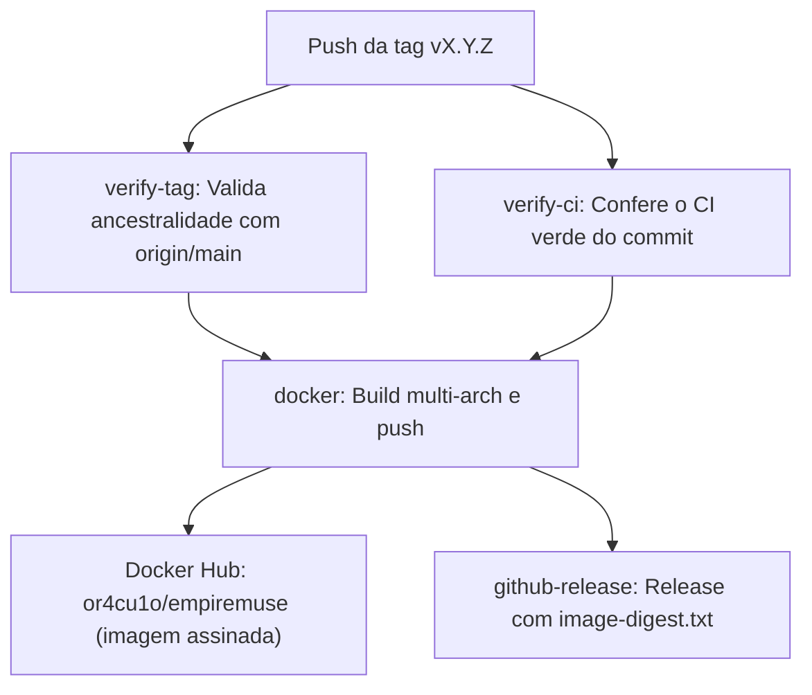

# Guia de Release e Publicação de Versões

Guia técnico para mantenedores do **EmpireMuse** detalhando a política de versionamento SemVer, o procedimento de publicação de versões, a esteira automatizada no GitHub Actions e a publicação de imagens multi-arquitetura no Docker Hub.

---

## 1. Estratégia de Versionamento (SemVer)

O EmpireMuse segue rigorosamente o padrão de [Versionamento Semântico 2.0.0](https://semver.org/lang/pt-BR/) (`MAJOR.MINOR.PATCH`):

- **MAJOR** (`X.0.0`): Mudanças incompatíveis na API, arquitetura ou nas configurações de banco de dados/execução.
- **MINOR** (`0.Y.0`): Novas funcionalidades mantendo compatibilidade retroativa.
- **PATCH** (`0.0.Z`): Correções de bugs, ajustes de documentação ou atualizações pontuais sem quebra de compatibilidade.

### 1.1 Versão do Projeto

- **Versionamento**: Em razão da reformulação profunda do bot frente ao upstream original, as publicações de teste da série 1.x foram retiradas e a primeira versão oficial do projeto é a **2.0.0** (as release candidates `2.0.0-rc.N` serviram só para homologar a 2.0.0).
- **Tags da imagem**: Cada release estável publica a versão exata (`X.Y.Z`), que por política nunca é republicada (a imutabilidade de tags do Docker Hub não está ativada), e atualiza as tags flutuantes `X.Y`, `X` e `latest`.
- **Releases de correção**: Saem como PATCH (`v2.0.1`, `v2.0.2`, …) pelo fluxo da seção 3, sem release candidate. Não há GitHub Release: a publicação é a imagem no Docker Hub.
- **Quando publicar**: A imagem só é gerada pelo push de uma tag `vX.Y.Z`; merge na `main` não gera imagem. Os merges se acumulam na seção `[Unreleased]` do `CHANGELOG.md` e viram **uma** release só quando há atualização que justifique uma imagem nova (correção ou recurso que muda o bot em execução). Mudanças de documentação, CI, testes e ajustes pequenos esperam a próxima release, e trabalhos paralelos em branches separadas são publicados juntos, numa release só, em vez de uma por merge.

---

## 2. Pré-requisitos de Configuração (Configuração Única)

A publicação automatizada de imagens no Docker Hub exige credenciais configuradas nos segredos do repositório no GitHub:

1. **Conta e Repositório no Docker Hub**:
   - Conta ou organização com acesso de publicação ao repositório `or4cu1o/empiremuse`.
2. **Personal Access Token (PAT) no Docker Hub**:
   - Gerar um token em **Account Settings > Security > New Access Token** com permissões de **Read & Write**.
3. **GitHub Actions Secrets e Environment `docker-release`**:
   - O proprietário do repositório deve configurar as variáveis de segredo no GitHub sem expor valores publicamente (seja a nível de repositório ou no ambiente **`docker-release`**, onde também é possível definir revisores obrigatórios para aprovar o deploy antes da publicação):
     - `DOCKERHUB_USERNAME`: Nome do usuário no Docker Hub (`or4cu1o`).
     - `DOCKERHUB_TOKEN`: Personal Access Token com permissão de escrita gerado no Docker Hub.
   
   A configuração pode ser realizada via interface web do GitHub ou pelo GitHub CLI (`gh`):
   ```bash
   gh secret set DOCKERHUB_USERNAME
   gh secret set DOCKERHUB_TOKEN
   ```

> [!NOTE]
> Essa configuração é feita apenas uma única vez. Se esses secrets não estiverem presentes, a etapa de autenticação no Docker Hub falhará durante o workflow de release.

---

## 3. Procedimento de Publicação Passo a Passo

Para manter a integridade do histórico do Git e a rastreabilidade das alterações, o fluxo de release deve ser executado rigorosamente na seguinte ordem:

### Passo 1: Atualizar o `CHANGELOG.md`

1. Na branch da tarefa/release, edite o arquivo [`CHANGELOG.md`](../../CHANGELOG.md);
2. Mova todas as alterações documentadas sob a seção `## [Unreleased]` para uma nova seção com o número da versão e a data correspondente:
   ```markdown
   ## [Unreleased]

   ## [2.0.0] - 2026-10-24
   ### Adicionado
   ...
   ```
3. Crie uma nova seção `## [Unreleased]` vazia no topo, pronta para os próximos ciclos de desenvolvimento.

### Passo 2: Submeter via Pull Request para a branch `main`

> [!IMPORTANT]
> A branch `main` possui proteção estrita contra commits diretos. Todas as alterações devem entrar via Pull Request.

1. Comite as alterações do `CHANGELOG.md` e abra um Pull Request apontando para `main`;
2. Aguarde a execução de todos os testes e verificações da esteira de integração contínua (CI);
3. Conclua o merge do PR na branch `main`.

### Passo 3: Criar a Tag Anotada no commit da `main`

Somente administradores podem criar tags `v*` (ruleset *Tags de release*). Depois do CI verde na `main`, crie a tag anotada no commit de merge do PR do `CHANGELOG.md`, conferindo antes as tags já existentes no Git e no Docker Hub:

```bash
git fetch origin --tags
git tag -a vX.Y.Z <commit-de-merge> -m "Release vX.Y.Z"
```

### Passo 4: Enviar a Tag para o Repositório Remoto

Envie a tag Git criada para o GitHub para disparar automaticamente o pipeline de release:

```bash
git push origin vX.Y.Z
```

### Passo 5: Implantar na VPS de Produção

A produção roda na VPS da Hostinger (Docker Manager), com o compose de [`deploy/docker-compose.hostinger.yml`](../../deploy/docker-compose.hostinger.yml) (ver [`docker.md`](docker.md), seção 3.6):

1. Confira a imagem publicada (seção 5);
2. Com o auto-update ligado, o dono só manda o comando `update` (veja [`auto-update.md`](auto-update.md)). Na primeira implantação, ou sem o auto-update, atualize as duas linhas `image:` do compose na VPS (seção 5.4): a do bot como `    image: or4cu1o/empiremuse:X.Y.Z@sha256:<digest>` (4 espaços) e a do `updater-proxy` mantendo o prefixo, `docker.io/or4cu1o/empiremuse:X.Y.Z@sha256:<digest>` (se o bot ficar fora dessa forma, todo `update` falha com o código 65), guardando antes um backup do arquivo (`docker-compose.yml.bak-AAAAMMDD-HHMMSS`), e a do `deploy/docker-compose.hostinger.yml` no repositório no próximo PR;
3. Sem o `update`, o dono reimplanta o projeto pelo painel da Hostinger;
4. Valide em produção: logs da subida, reprodução (YouTube e SoundCloud), painel e RPC.

---

## 4. O que o Workflow de Release Faz

O arquivo de workflow [`.github/workflows/release.yml`](../../.github/workflows/release.yml) é acionado exclusivamente no push de tags no formato `v*.*.*`. Ele é dividido em quatro fases coordenadas:



### 4.1 Validação de Tag (`verify-tag`)
- Executa `git merge-base --is-ancestor HEAD origin/main`.
- **Garantia de segurança**: Se a tag apontar para um commit que não pertence ao histórico da branch `origin/main` (por exemplo, uma tag acidental em uma branch de feature ou trabalho isolado), o workflow falha imediatamente e aborta a esteira, impedindo a publicação indevida de imagens.

### 4.2 Conferência do CI (`verify-ci`)
- Não roda os testes de novo: consulta o workflow **CI** do commit da tag (`gh run list --workflow CI --commit <sha>`).
- Se não houver nenhuma execução do CI concluída com sucesso para esse commit, a imagem não é construída nem publicada.

### 4.3 Build e Push da Imagem (`docker`)
- Configura emulação **QEMU** e **Docker Buildx** para compilação multi-plataforma nativa;
- Autentica-se no Docker Hub utilizando os segredos `DOCKERHUB_USERNAME` e `DOCKERHUB_TOKEN`;
- **Multi-Arquitetura**: Constrói a imagem simultaneamente para `linux/amd64` (servidores x86_64 padrão) e `linux/arm64` (Apple Silicon, Raspberry Pi 4/5, servidores ARM na nuvem);
- **Segurança da Cadeia de Suprimentos (Supply Chain)**:
  - **SBOM** (`sbom: true`): Gera e anexa o inventário de software (Software Bill of Materials) diretamente ao registro;
  - **Provenance** (`provenance: mode=max`): Gera atestações criptográficas de procedência de compilação em conformidade com o nível SLSA;
- **Versão dentro da imagem**: o `build-args` passa `EMPIREMUSE_VERSION` (a versão da tag, sem o `v`) para o Dockerfile, e o bot a lê para saber que versão está rodando (`empiremuse/version.py`). Builds locais ficam com `dev`;
- **Imagem nunca reconstruída**: antes do build, o job falha se `or4cu1o/empiremuse:<versão>` já existe (reexecutar uma tag publicada trocaria o digest e republicaria as tags flutuantes, e o `image-digest.txt` imutável ficaria com o digest antigo);
- **Assinatura (cosign keyless, cosign v3.1.3 fixado no instalador)**: só o job `docker` tem `id-token: write`. Depois do push, o job valida o digest (`^sha256:[0-9a-f]{64}$`), assina `or4cu1o/empiremuse@<digest>` pela identidade OIDC do GitHub (Sigstore, sem chave guardada) e roda `cosign verify` no mesmo digest, exigindo a identidade exata deste `release.yml` na ref da tag. Se assinar ou verificar falhar, o job falha e a versão não é anunciada (fail-closed). O digest sai como saída do job;
- **Regras de Versionamento de Tags da Imagem**:
  - **Versão Final Estável** (`vX.Y.Z`, ex.: `v2.0.0`):
    - Publica a tag de versão exata `X.Y.Z` (`2.0.0`), que nunca é republicada, além das tags flutuantes `X.Y` (`2.0`), `X` (`2`, gerada para versões ≥ 1.0 via `enable=${{ !startsWith(github.ref_name, 'v0.') }}`) e `latest` (graças ao modificador `latest=auto`), que são atualizadas a cada nova release estável.
  - **Release Candidate** (`vX.Y.Z-rc.N`, ex.: `v2.0.0-rc.1`; o workflow ainda aceita, mas o fluxo atual não usa RC, ver seção 1.1):
    - Publica **estritamente** a tag do pré-lançamento (`2.0.0-rc.1`), **sem alterar nem sobrescrever** as tags flutuantes `2`, `2.0`, `latest` nem as tags de versões estáveis anteriores.

### 4.4 GitHub Release com o digest (`github-release`)
- Roda depois do `docker`, com `contents: write` e nenhuma outra permissão (nenhum outro job ganha permissão nova);
- Cria a GitHub Release da tag (`gh release create --verify-tag`), com as notas tiradas da seção `## [X.Y.Z]` do `CHANGELOG.md` (release estável sem a seção falha) e o asset `image-digest.txt`, que tem exatamente uma linha `sha256:<64 hex>`. Tags `-rc.N` saem marcadas como pré-lançamento;
- O asset é enviado já na criação: com **releases imutáveis** ligadas no repositório (pré-requisito do auto-update), uma release criada assim não pode mais ter o asset trocado. O bot só oferece versões que tenham essa release.

> [!IMPORTANT]
> Antes de publicar uma versão que o auto-update deva oferecer, ligue **Releases imutáveis** em *Settings > General* do repositório; só as releases criadas depois ficam imutáveis.

---

## 5. Como Conferir a Publicação

Após a conclusão com sucesso do workflow no GitHub Actions, realize a verificação externa:

### 5.1 Teste de Pull Anônimo
Em um terminal independente (ou sem autenticação no Docker Hub), teste o download da imagem publicada para validar que o repositório é público e acessível:

```bash
docker pull or4cu1o/empiremuse:2.0.0
```

*(Substitua `2.0.0` pela tag publicada, como `2.0.2` ou `2`)*.

### 5.2 Inspeção do Manifesto Multi-Arquitetura
Utilize o comando `docker buildx imagetools inspect` para verificar as arquiteturas publicadas e os atestados de segurança:

```bash
docker buildx imagetools inspect or4cu1o/empiremuse:2.0.0
```

O comando exibirá a lista de manifestos contendo:
- Plataforma `linux/amd64`;
- Plataforma `linux/arm64`;
- Camadas de atestação (`application/vnd.in-toto+json`) referentes ao SBOM e Provenance.

### 5.3 Verificação da Assinatura e do Digest
O workflow já verificou a assinatura; para repetir como uma pessoa, instale o [cosign](https://docs.sigstore.dev/cosign/system_config/installation/), baixe o digest fixado da GitHub Release e verifique **o objeto pelo digest**, trocando `X.Y.Z` pela versão:

```bash
DIGEST=$(gh release download vX.Y.Z --repo EmpireCommunity/EmpireMuse -p image-digest.txt -O -)
cosign verify \
  --certificate-oidc-issuer https://token.actions.githubusercontent.com \
  --certificate-identity "https://github.com/EmpireCommunity/EmpireMuse/.github/workflows/release.yml@refs/tags/vX.Y.Z" \
  "or4cu1o/empiremuse@${DIGEST}"
```

Use o mesmo digest para fixar a imagem como `or4cu1o/empiremuse:X.Y.Z@sha256:<digest>` em um compose.

### 5.4 Digest para o Compose do Auto-update

O [`deploy/docker-compose.hostinger.yml`](../../deploy/docker-compose.hostinger.yml) (e o [`deploy/docker-compose.hostinger-sem-traefik.yml`](../../deploy/docker-compose.hostinger-sem-traefik.yml), com as mesmas duas linhas; índice em [`deploy/README.md`](../../deploy/README.md)) traz dois marcadores de zeros (`@sha256:000…`): a imagem do `bot` e a do `updater-proxy`. Troque os dois pelo conteúdo do `image-digest.txt` da GitHub Release da mesma versão (o comando de download está na seção 5.3); o passo a passo completo está em [`auto-update.md`](auto-update.md), seção 2.1. O `image-digest.txt` só é confiável em releases imutáveis (seção 4.4). O `update` só troca a linha do bot; a imagem do `updater-proxy` só muda quando o dono troca o digest dela à mão (por exemplo, sempre que o `CHANGELOG.md` citar o proxy).

---

## 6. O que Fazer em Caso de Erro na Tag ou na Release

> [!CAUTION]
> **NUNCA REAPROVEITE OU SOBRESCREVA UMA TAG DE RELEASE `vX.Y.Z` JÁ PUBLICADA!**

A tag de versão exata `X.Y.Z` (ex.: `2.0.0`) da imagem e as tags Git no repositório nunca são republicadas nem movidas (por política; no Git, reforçado pelo ruleset abaixo). As tags `X` (ex.: `2`), `X.Y` (ex.: `2.0`) e `latest` são **tags flutuantes** mantidas intencionalmente atualizadas para apontar para o release estável mais recente da série. No entanto, apagar uma tag remota (`git push origin :vX.Y.Z`) ou forçar a sua sobrescrita/movimentação (`git push --force origin vX.Y.Z`) quebra caches, invalida deploys reproduzíveis e compromete a rastreabilidade e integridade do projeto. Além disso, o ruleset de proteção do repositório (*Tags de release*) restringe a criação, atualização forçada e exclusão de tags `v*` exclusivamente a administradores do repositório.

Se for detectado qualquer defeito de código, falha de empacotamento ou inconsistência após a publicação:

1. Trate o problema normalmente via branch de correção (`fix/...`) e submeta o Pull Request para a `main`;
2. Após o merge na `main`, incremente o número da versão conforme as regras do SemVer:
   - Se o erro ocorreu em uma versão estável (ex.: `v2.0.2`), publique a versão corretiva de patch seguinte (`v2.0.3`);
3. Crie e envie a nova tag Git no commit atualizado da `main`.

### 6.1 Falha do workflow depois do push da imagem
A imagem é enviada ao Docker Hub **antes** da assinatura e da GitHub Release. Se `cosign sign`, `cosign verify` ou a criação da Release falharem:
- A versão **não** é anunciada ao bot (sem Release com `image-digest.txt`), mas a imagem já publicada continua no Hub;
- **Não reexecute o job `docker`**: ele recusa a tag (a imagem já existe), de propósito. Reconstruir trocaria o digest, e assinar uma imagem já existente sem prova de que veio desta tag deixaria um push indevido (por exemplo, com um token vazado do Hub) ganhar assinatura;
- Se só o job `github-release` falhou, reexecute **apenas esse job** (o `docker` já terminou e o digest é o mesmo);
- Nos demais casos, trate como defeito: publique a próxima versão de patch, como acima.
