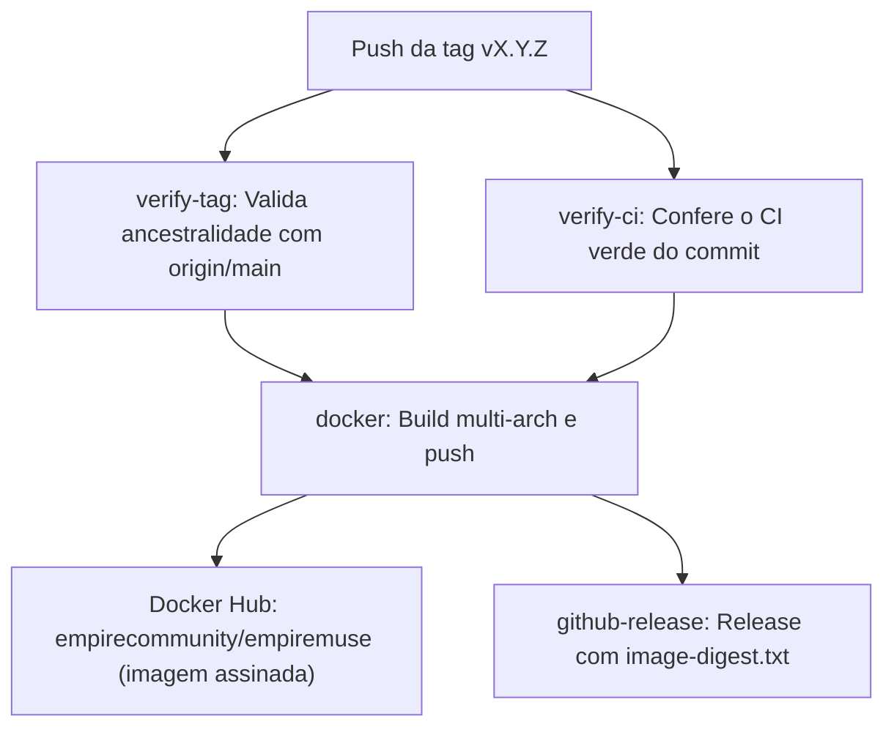

# Guia de Release e Publicação de Versões

Guia técnico para mantenedores do **EmpireMuse** detalhando a política de versionamento SemVer, o procedimento de publicação de versões, a esteira automatizada no GitHub Actions e a publicação de imagens multi-arquitetura no Docker Hub.

---

## 1. Estratégia de Versionamento (SemVer)

O EmpireMuse segue rigorosamente o padrão de [Versionamento Semântico 2.0.0](https://semver.org/lang/pt-BR/) (`MAJOR.MINOR.PATCH`):

- **MAJOR** (`X.0.0`): Mudanças incompatíveis na API, arquitetura ou nas configurações de banco de dados/execução.
- **MINOR** (`0.Y.0`): Novas funcionalidades mantendo compatibilidade retroativa.
- **PATCH** (`0.0.Z`): Correções de bugs, ajustes de documentação ou atualizações pontuais sem quebra de compatibilidade.

### 1.1 Versão do Projeto

- **Versionamento**: Em razão da reformulação profunda do bot frente ao upstream original, as publicações de teste da série 1.x foram retiradas e a primeira versão oficial do projeto é a **2.0.0** (as release candidates `2.0.0-rc.N` serviram só para homologar a 2.0.0).
- **Tags da imagem**: Cada release estável publica a versão exata (`X.Y.Z`), que por política nunca é republicada (a imutabilidade de tags do Docker Hub não está ativada), e atualiza as tags flutuantes `X.Y`, `X` e `latest`.
- **Releases de correção**: Saem como PATCH (`v2.0.1`, `v2.0.2`, …) pelo fluxo da seção 3, sem release candidate. Não há GitHub Release: a publicação é a imagem no Docker Hub.
- **Quando publicar**: A imagem só é gerada pelo push de uma tag `vX.Y.Z`; merge na `main` não gera imagem. Os merges se acumulam na seção `[Unreleased]` do `CHANGELOG.md` e viram **uma** release só quando há atualização que justifique uma imagem nova (correção ou recurso que muda o bot em execução). Mudanças de documentação, CI, testes e ajustes pequenos esperam a próxima release, e trabalhos paralelos em branches separadas são publicados juntos, numa release só, em vez de uma por merge.

---

## 2. Pré-requisitos de Configuração (Configuração Única)

A publicação automatizada de imagens no Docker Hub depende de um repositório público e de credenciais guardadas como **segredos da organização** no GitHub:

1. **Repositório no Docker Hub**: `empirecommunity/empiremuse` tem de existir e ser **público** antes de a tag ser enviada (sem ele o push falha e o pull anônimo da seção 5.1 não funciona). Na publicação dupla (seção 7), `or4cu1o/empiremuse` também tem de aceitar o push.
2. **Token do Docker Hub**: um Personal Access Token com **Read & Write**, de um usuário com **permissão de escrita no repositório da organização** (e no `or4cu1o/empiremuse` enquanto houver publicação dupla). Gere em **Account Settings > Security > New Access Token**.
3. **Segredos da organização `EmpireCommunity`**: `DOCKERHUB_USERNAME` (o usuário dono do token) e `DOCKERHUB_TOKEN` são **segredos da organização**, com acesso restrito a **Selected repositories** (só este repositório). O job `docker` roda no ambiente **`docker-release`** (onde também é possível exigir revisores antes da publicação).

> [!WARNING]
> Um segredo com o mesmo nome no **repositório** ou no ambiente **`docker-release`** tem precedência sobre o da organização e o esconde. Esses segredos locais **não devem existir**: confira em *Settings > Secrets and variables > Actions* do repositório e do ambiente. Não crie nem altere segredos por comando de terminal sem o OK do dono; os valores nunca entram em arquivo, log ou conversa.

> [!NOTE]
> Essa configuração é feita uma única vez. Se os segredos não estiverem acessíveis ao repositório, a etapa de autenticação no Docker Hub falha durante o workflow de release.

---

## 3. Procedimento de Publicação Passo a Passo

Para manter a integridade do histórico do Git e a rastreabilidade das alterações, o fluxo de release deve ser executado rigorosamente na seguinte ordem:

### Passo 1: Atualizar o `CHANGELOG.md`

1. Na branch da tarefa/release, edite o arquivo [`CHANGELOG.md`](../../CHANGELOG.md);
2. Mova todas as alterações documentadas sob a seção `## [Unreleased]` para uma nova seção com o número da versão e a data correspondente:
   ```markdown
   ## [Unreleased]

   ## [2.0.0] - 2026-10-24
   ### Adicionado
   ...
   ```
3. Crie uma nova seção `## [Unreleased]` vazia no topo, pronta para os próximos ciclos de desenvolvimento.

### Passo 2: Submeter via Pull Request para a branch `main`

> [!IMPORTANT]
> A branch `main` possui proteção estrita contra commits diretos. Todas as alterações devem entrar via Pull Request.

1. Comite as alterações do `CHANGELOG.md` e abra um Pull Request apontando para `main`;
2. Aguarde a execução de todos os testes e verificações da esteira de integração contínua (CI);
3. Conclua o merge do PR na branch `main`.

### Passo 3: Criar a Tag Anotada no commit da `main`

Somente administradores podem criar tags `v*` (ruleset *Tags de release*). Depois do CI verde na `main`, crie a tag anotada no commit de merge do PR do `CHANGELOG.md`, conferindo antes as tags já existentes no Git e no Docker Hub:

```bash
git fetch origin --tags
git tag -a vX.Y.Z <commit-de-merge> -m "Release vX.Y.Z"
```

### Passo 4: Enviar a Tag para o Repositório Remoto

Envie a tag Git criada para o GitHub para disparar automaticamente o pipeline de release:

```bash
git push origin vX.Y.Z
```

### Passo 5: Implantar na VPS de Produção

A produção roda na VPS da Hostinger (Docker Manager), com o compose de [`deploy/docker-compose.hostinger.yml`](../../deploy/docker-compose.hostinger.yml) (ou o [`deploy/docker-compose.hostinger-sem-traefik.yml`](../../deploy/docker-compose.hostinger-sem-traefik.yml), para quem não usa o Traefik; ver [`docker.md`](docker.md), seção 3.6):

1. Confira a imagem publicada (seção 5);
2. Com o auto-update ligado, o dono só manda o comando `update` (veja [`auto-update.md`](auto-update.md)). Na primeira implantação, ou sem o auto-update, atualize as duas linhas `image:` do compose na VPS (seção 5.4): a do bot como `    image: empirecommunity/empiremuse:X.Y.Z@sha256:<digest>` (4 espaços) e a do `updater-proxy` mantendo o prefixo, `docker.io/empirecommunity/empiremuse:X.Y.Z@sha256:<digest>` (se o bot ficar fora dessa forma, todo `update` falha com o código 65), guardando antes um backup do arquivo (`docker-compose.yml.bak-AAAAMMDD-HHMMSS`), e a do `deploy/docker-compose.hostinger.yml` no repositório no próximo PR;
3. Sem o `update`, o dono reimplanta o projeto pelo painel da Hostinger;
4. Valide em produção: logs da subida, reprodução (YouTube e SoundCloud), painel e RPC.

---

## 4. O que o Workflow de Release Faz

O arquivo de workflow [`.github/workflows/release.yml`](../../.github/workflows/release.yml) é acionado exclusivamente no push de tags no formato `v*.*.*`. Ele é dividido em quatro fases coordenadas:



### 4.1 Validação de Tag (`verify-tag`)
- Executa `git merge-base --is-ancestor HEAD origin/main`.
- **Garantia de segurança**: Se a tag apontar para um commit que não pertence ao histórico da branch `origin/main` (por exemplo, uma tag acidental em uma branch de feature ou trabalho isolado), o workflow falha imediatamente e aborta a esteira, impedindo a publicação indevida de imagens.

### 4.2 Conferência do CI (`verify-ci`)
- Não roda os testes de novo: consulta o workflow **CI** do commit da tag (`gh run list --workflow CI --commit <sha>`).
- Se não houver nenhuma execução do CI concluída com sucesso para esse commit, a imagem não é construída nem publicada.

### 4.3 Build e Push da Imagem (`docker`)
- Configura emulação **QEMU** e **Docker Buildx** para compilação multi-plataforma nativa;
- Autentica-se no Docker Hub utilizando os segredos `DOCKERHUB_USERNAME` e `DOCKERHUB_TOKEN`;
- **Multi-Arquitetura**: Constrói a imagem simultaneamente para `linux/amd64` (servidores x86_64 padrão) e `linux/arm64` (Apple Silicon, Raspberry Pi 4/5, servidores ARM na nuvem);
- **Segurança da Cadeia de Suprimentos (Supply Chain)**:
  - **SBOM** (`sbom: true`): Gera e anexa o inventário de software (Software Bill of Materials) diretamente ao registro;
  - **Provenance** (`provenance: mode=max`): Gera atestações criptográficas de procedência de compilação em conformidade com o nível SLSA;
- **Versão dentro da imagem**: o `build-args` passa `EMPIREMUSE_VERSION` (a versão da tag, sem o `v`) para o Dockerfile, e o bot a lê para saber que versão está rodando (`empiremuse/version.py`). Builds locais ficam com `dev`;
- **Repositórios de destino**: a lista `IMAGE_REPOS` (variável `env` do job `docker`, um repositório por linha) alimenta o `images` do `docker/metadata-action`, a conferência de tag livre, a assinatura e a verificação. Um único build empurra o mesmo índice para todos os repositórios: o digest, o SBOM e a procedência são idênticos e o `image-digest.txt` vale para qualquer um;
- **Imagem nunca reconstruída**: antes do build, o job falha se `<repositório>:<versão>` já existe em qualquer repositório da lista `IMAGE_REPOS` (reexecutar uma tag publicada trocaria o digest e republicaria as tags flutuantes, e o `image-digest.txt` imutável ficaria com o digest antigo);
- **Assinatura (cosign keyless, cosign v3.1.3 fixado no instalador)**: só o job `docker` tem `id-token: write`. Depois do push, o job valida o digest (`^sha256:[0-9a-f]{64}$`), assina `<repositório>@<digest>` em cada repositório da lista pela identidade OIDC do GitHub (Sigstore, sem chave guardada) e roda `cosign verify` no mesmo digest em cada repositório, exigindo a identidade exata deste `release.yml` na ref da tag. Se assinar ou verificar falhar, o job falha e a versão não é anunciada (fail-closed). O digest sai como saída do job;
- **Regras de Versionamento de Tags da Imagem**:
  - **Versão Final Estável** (`vX.Y.Z`, ex.: `v2.0.0`):
    - Publica a tag de versão exata `X.Y.Z` (`2.0.0`), que nunca é republicada, além das tags flutuantes `X.Y` (`2.0`), `X` (`2`, gerada para versões ≥ 1.0 via `enable=${{ !startsWith(github.ref_name, 'v0.') }}`) e `latest` (graças ao modificador `latest=auto`), que são atualizadas a cada nova release estável.
  - **Release Candidate** (`vX.Y.Z-rc.N`, ex.: `v2.0.0-rc.1`; o workflow ainda aceita, mas o fluxo atual não usa RC, ver seção 1.1):
    - Publica **estritamente** a tag do pré-lançamento (`2.0.0-rc.1`), **sem alterar nem sobrescrever** as tags flutuantes `2`, `2.0`, `latest` nem as tags de versões estáveis anteriores.

### 4.4 GitHub Release com o digest (`github-release`)
- Roda depois do `docker`, com `contents: write` e nenhuma outra permissão (nenhum outro job ganha permissão nova);
- Cria a GitHub Release da tag (`gh release create --verify-tag`), com as notas tiradas da seção `## [X.Y.Z]` do `CHANGELOG.md` (release estável sem a seção falha) e o asset `image-digest.txt`, que tem exatamente uma linha `sha256:<64 hex>`. Tags `-rc.N` saem marcadas como pré-lançamento;
- O asset é enviado já na criação: com **releases imutáveis** ligadas no repositório (pré-requisito do auto-update), uma release criada assim não pode mais ter o asset trocado. O bot só oferece versões que tenham essa release.

> [!IMPORTANT]
> Antes de publicar uma versão que o auto-update deva oferecer, ligue **Releases imutáveis** em *Settings > General* do repositório; só as releases criadas depois ficam imutáveis.

---

## 5. Como Conferir a Publicação

Após a conclusão com sucesso do workflow no GitHub Actions, realize a verificação externa:

### 5.1 Teste de Pull Anônimo
Em um terminal independente (ou sem autenticação no Docker Hub), teste o download da imagem publicada para validar que o repositório é público e acessível:

```bash
docker pull empirecommunity/empiremuse:2.0.0
```

*(Substitua `2.0.0` pela tag publicada, como `2.0.2` ou `2`)*.

### 5.2 Inspeção do Manifesto Multi-Arquitetura
Utilize o comando `docker buildx imagetools inspect` para verificar as arquiteturas publicadas e os atestados de segurança:

```bash
docker buildx imagetools inspect empirecommunity/empiremuse:2.0.0
```

O comando exibirá a lista de manifestos contendo:
- Plataforma `linux/amd64`;
- Plataforma `linux/arm64`;
- Camadas de atestação (`application/vnd.in-toto+json`) referentes ao SBOM e Provenance.

### 5.3 Verificação da Assinatura e do Digest
O workflow já verificou a assinatura; para repetir como uma pessoa, instale o [cosign](https://docs.sigstore.dev/cosign/system_config/installation/), baixe o digest fixado da GitHub Release e verifique **o objeto pelo digest**, trocando `X.Y.Z` pela versão:

```bash
DIGEST=$(gh release download vX.Y.Z --repo EmpireCommunity/EmpireMuse -p image-digest.txt -O -)
cosign verify \
  --certificate-oidc-issuer https://token.actions.githubusercontent.com \
  --certificate-identity "https://github.com/EmpireCommunity/EmpireMuse/.github/workflows/release.yml@refs/tags/vX.Y.Z" \
  "empirecommunity/empiremuse@${DIGEST}"
```

Use o mesmo digest para fixar a imagem como `empirecommunity/empiremuse:X.Y.Z@sha256:<digest>` em um compose.

### 5.4 Digest para o Compose do Auto-update

O [`deploy/docker-compose.hostinger.yml`](../../deploy/docker-compose.hostinger.yml) (e o [`deploy/docker-compose.hostinger-sem-traefik.yml`](../../deploy/docker-compose.hostinger-sem-traefik.yml), com as mesmas duas linhas; índice em [`deploy/README.md`](../../deploy/README.md)) traz dois marcadores de zeros (`@sha256:000…`): a imagem do `bot` e a do `updater-proxy`. Troque os dois pelo conteúdo do `image-digest.txt` da GitHub Release da mesma versão (o comando de download está na seção 5.3); o passo a passo completo está em [`auto-update.md`](auto-update.md), seção 2.1. O `image-digest.txt` só é confiável em releases imutáveis (seção 4.4). O `update` só troca a linha do bot; a imagem do `updater-proxy` só muda quando o dono troca o digest dela à mão (por exemplo, sempre que o `CHANGELOG.md` citar o proxy).

---

## 6. O que Fazer em Caso de Erro na Tag ou na Release

> [!CAUTION]
> **NUNCA REAPROVEITE OU SOBRESCREVA UMA TAG DE RELEASE `vX.Y.Z` JÁ PUBLICADA!**

A tag de versão exata `X.Y.Z` (ex.: `2.0.0`) da imagem e as tags Git no repositório nunca são republicadas nem movidas (por política; no Git, reforçado pelo ruleset abaixo). As tags `X` (ex.: `2`), `X.Y` (ex.: `2.0`) e `latest` são **tags flutuantes** mantidas intencionalmente atualizadas para apontar para o release estável mais recente da série. No entanto, apagar uma tag remota (`git push origin :vX.Y.Z`) ou forçar a sua sobrescrita/movimentação (`git push --force origin vX.Y.Z`) quebra caches, invalida deploys reproduzíveis e compromete a rastreabilidade e integridade do projeto. Além disso, o ruleset de proteção do repositório (*Tags de release*) restringe a criação, atualização forçada e exclusão de tags `v*` exclusivamente a administradores do repositório.

Se for detectado qualquer defeito de código, falha de empacotamento ou inconsistência após a publicação:

1. Trate o problema normalmente via branch de correção (`fix/...`) e submeta o Pull Request para a `main`;
2. Após o merge na `main`, incremente o número da versão conforme as regras do SemVer:
   - Se o erro ocorreu em uma versão estável (ex.: `v2.0.2`), publique a versão corretiva de patch seguinte (`v2.0.3`);
3. Crie e envie a nova tag Git no commit atualizado da `main`.

### 6.1 Falha do workflow depois do push da imagem
A imagem é enviada ao Docker Hub **antes** da assinatura e da GitHub Release. Se `cosign sign`, `cosign verify` ou a criação da Release falharem:
- A versão **não** é anunciada ao bot (sem Release com `image-digest.txt`), mas a imagem já publicada continua no Hub;
- **Não reexecute o job `docker`**: ele recusa a tag (a imagem já existe), de propósito. Reconstruir trocaria o digest, e assinar uma imagem já existente sem prova de que veio desta tag deixaria um push indevido (por exemplo, com um token vazado do Hub) ganhar assinatura;
- Na publicação dupla (seção 7), o push que falhar em um dos repositórios deixa a versão num só: a conferência de tag livre também recusa essa reexecução. Trate como defeito e publique o patch seguinte: ele passa a ser a release de publicação dupla (seção 7), e a retirada do repositório antigo (7.1) só vale depois dele;
- Se só o job `github-release` falhou, reexecute **apenas esse job** (o `docker` já terminou e o digest é o mesmo);
- Nos demais casos, trate como defeito: publique a próxima versão de patch, como acima.

---

## 7. Migração para `empirecommunity/empiremuse` e aposentadoria do repositório antigo

Decisão do dono (2026-11-10): a imagem passa a ser publicada na organização, `empirecommunity/empiremuse`. O repositório antigo, `or4cu1o/empiremuse`, **mantém as imagens que já tem** (nunca apague nem reetiquete). A **primeira release publicada com este workflow** (a 2.3.0, como planejado) sai **nos dois repositórios**, assinada e verificada nos dois; da release seguinte em diante, só no novo.

Essa release só conta como feita quando os jobs `docker` e `github-release` terminaram **verdes** (imagem publicada, assinada e verificada nos dois repositórios, Release criada com o `image-digest.txt`). Se ela falhar ou for substituída por um patch (seção 6), a primeira release que passar por inteiro é a de publicação dupla, e as etapas abaixo valem para ela, com a versão dela no lugar de `2.3.0`.

### 7.1 Retirar o repositório antigo (primeiro PR depois dessa release)

1. Confirme que a release de publicação dupla está nos dois repositórios com o mesmo digest (`docker buildx imagetools inspect <repo>:X.Y.Z` em cada um e o `cosign verify` da seção 5.3 para cada um) e que a produção do dono já foi migrada (7.2).
2. Só então, em `.github/workflows/release.yml`, apague a linha `or4cu1o/empiremuse` de `IMAGE_REPOS` (job `docker`). Nada mais muda no workflow: o `images`, a conferência de tag livre, a assinatura e a verificação leem a lista.
3. Registre no `CHANGELOG.md` que a imagem vive só em `empirecommunity/empiremuse` e que o repositório antigo ficou congelado na release de publicação dupla (as tags `latest`, `2` e `2.X` dele param nela; quem usa `or4cu1o/empiremuse:latest` ou `:2` não recebe mais nada).

### 7.2 Troca manual da produção (uma vez, depois da release de publicação dupla)

O proxy de atualização roda de uma imagem fixada à mão e as versões anteriores a essa release só aceitam `or4cu1o/empiremuse` (o `/update` nunca troca de repositório). Com a 2.3.0 como release de publicação dupla, a ordem é:

1. `update` para a 2.3.0 pelo bot: o proxy antigo baixa `or4cu1o/empiremuse:2.3.0@<digest>`, que existe porque a 2.3.0 é publicada nos dois. O bot sobe na 2.3.0; o `updater-proxy` continua na imagem antiga (o `update` só troca a linha do bot).
2. Antes de existir a release seguinte, na VPS, com o OK do dono:
   1. Pegue o digest do `image-digest.txt` da GitHub Release (nunca da página do Docker Hub) e confira a assinatura no repositório novo, como na seção 5.3:

      ```bash
      DIGEST=$(gh release download v2.3.0 --repo EmpireCommunity/EmpireMuse -p image-digest.txt -O -)
      cosign verify \
        --certificate-oidc-issuer https://token.actions.githubusercontent.com \
        --certificate-identity "https://github.com/EmpireCommunity/EmpireMuse/.github/workflows/release.yml@refs/tags/v2.3.0" \
        "empirecommunity/empiremuse@${DIGEST}"
      ```

      Se a verificação falhar, pare: não troque nenhuma linha.
   2. Guarde o backup do compose (`docker-compose.yml.bak-AAAAMMDD-HHMMSS`) e troque as duas linhas `image:`, mantendo a forma e o digest verificado (o mesmo nos dois repositórios):
      - bot: `    image: empirecommunity/empiremuse:2.3.0@sha256:<digest>` (4 espaços);
      - `updater-proxy`: `    image: docker.io/empirecommunity/empiremuse:2.3.0@sha256:<digest>`;
   3. Reimplante o projeto pelo painel (ou `docker compose up -d bot updater-proxy`). O proxy 2.3.0 já tem `empirecommunity/empiremuse` como padrão, e o auxiliar passa a casar a linha do bot com esse repositório.
3. Sem o passo 2, o `update` para a release seguinte não muda nada: o proxy antigo tenta baixar do `or4cu1o/empiremuse`, onde ela não existe (código 66, "não consegui baixar a imagem; nada mudou"). Se a linha do bot já estiver no repositório novo e o proxy ainda no antigo, o auxiliar não acha a linha e sai com o código 65 (também sem alterar nada).

Alterar a produção só com o OK do dono, em uma implantação aprovada.
